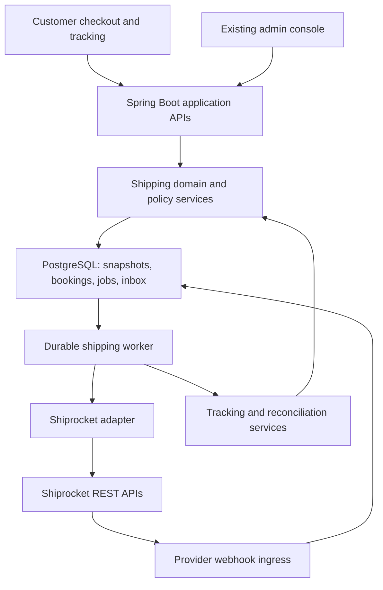

# Shiprocket integration — High-level design

- **Project:** AJPrj/ecommerce-production-blueprint
- **Version:** 1.1 — proposed implementation design, reconciled with targeted application review
- **Prepared:** 16 October 2026
- **Revised:** 16 October 2026
- **Documentation baseline revision:** `7808336b2b74a0c25aecd04598ae002c39b9bb79`
- **Delivery model:** Extend the existing React/Spring Boot modular monolith; admin-controlled assisted fulfillment first.

## 1. Purpose and design outcome

Integrate Shiprocket as the real shipping provider behind the existing fulfillment workflows. Customers select a delivery service level once; staff confirm packaging and approve courier booking. The application handles quotes, provider order creation, AWB assignment, documents, pickup, tracking, exceptions and reverse shipping through durable operations.

The initial design was based on the documentation repository. Version 1.1 incorporates targeted local application review of package creation, commercial/COD allocation, return eligibility and customer tracking; it is not a full source-code audit or new runtime acceptance evidence. Proposed behavior remains implementation work. The documentation baseline above does not identify a reviewed application commit; relevant local source paths are recorded in section 19. This revision changes documentation only; application code and live Shiprocket account settings are unchanged.

### Evidence and precedence

Use current implementation notes and the tracker for implemented behavior, commerce decisions/effective settings for commercial policy, and the general blueprint for architectural direction. Older roadmap paragraphs that call fulfillment unimplemented are superseded by the newer Stage 2/admin implementation records.

| Source document | Consequence for this design |
|---|---|
| `00-README.md`, `ARCHITECTURE-DECISIONS.md`, `04-backend-architecture.md` | Java 21 / Spring Boot baseline, React/TypeScript, PostgreSQL, Redis support, modular monolith and provider boundaries |
| `ADMIN-CONSOLE-IMPLEMENTATION.md`, `18-admin-console-blueprint.md` | Extend the implemented admin shell, capabilities, orders, fulfillment, returns, settings and dashboard |
| `STAGE-2-OPERATIONS.md` | Preserve package allocation, explicit dispatch, stock accounting, tracking, quarantine and existing operations contracts |
| `IMPLEMENTATION-TRACKER.md` | V23 cancellation/COD and V24–V28 admin work are recorded; real carrier and operational acceptance remain open |
| `COMMERCE-DECISIONS.md`, `ADMIN-PROMOTIONS.md` | Preserve customer shipping pricing, original merchandise threshold basis, discounts and immutable tax snapshots |
| `05-rest-api-design.md`, `07-postgresql-database-architecture.md`, `09-reliability-distributed-systems.md` | Versioned API, durable idempotency, additive migrations, outbox, bounded retries and reconciliation |
| `08-security.md`, `11-observability.md`, `14-testing-strategy.md`, `15-production-readiness-checklist.md` | Backend authorization, CSRF, safe telemetry, concurrency tests and evidence-based release gates |

Repository source links are in section 19.

## 2. Existing baseline and scope

Implementation has started with a limited, explicitly configured MOCK provider-create foundation. See [implementation progress](SHIPROCKET-IMPLEMENTATION.md) and the [tracker](IMPLEMENTATION-TRACKER.md) for current evidence and remaining phases; the full workflows in this HLD are not yet implemented.

The current documentation records a dedicated lazy-loaded admin console, API-backed split-package fulfillment, exactly-once dispatch stock consumption, return allocation/inspection, online refunds, COD collection/manual refund commands, effective-dated settings and granular capability projections. The normal carrier adapter still refuses real label creation; development profiles generate SANDBOX/DEV references. Durable outbox records exist, but full production worker operation remains an open Stage 3 gate. Shipping must implement the worker capabilities it needs rather than assume those records are already delivered.

### Required application changes identified by review

| Area | Behavior at design review | Required implementation delta |
|---|---|---|
| Package creation and edits | `ShippingService.create` calls `CarrierAdapter.createLabel` inside the preparation transaction; the proposed provider creation precedes AWB assignment | Separate local preparation from external creation/labels; freeze parcel inputs when create intent is committed and coordinate cancellation/replacement for later corrections |
| Commercial/COD allocation | `CommercialAllocationService.collectionCap` assigns remainder paise using previous collections/cancellations; `CodService.collect` verifies that recalculated amount | Persist shared commercial quantity allocations before provider creation; booking, collection, cancellation and return/refund limits must use the same saved amounts |
| Reverse identity | Returns can claim different remaining units from the same forward package | Give each reverse physical parcel its own return-linked identity and allocations; enforce booking uniqueness per reverse parcel |
| Return eligibility and UI | `ReturnService.request` and `OrderTracking` require the whole order to be `DELIVERED` | Validate and expose eligible delivered quantities independently of the aggregate order status, including delivered + in-transit/RTO/lost outcomes |

These changes extend the existing domain services and contracts. They are acceptance requirements, not claims that the application already implements them.

### Included

- Domestic single-seller shipments from a registered Kerala pickup location, with package-based provider mappings.
- Checkout serviceability, delivery estimates and service-level snapshots.
- Standard delivery with the existing customer-price policy; Express behind approved effective configuration.
- Assisted/admin-approved courier selection, booking, label/manifest generation and pickup.
- Tracking, cancellation reconciliation, delivery exceptions, RTO visibility and approved reverse shipments.
- Provider credentials/token management, durable jobs, audit, security, metrics and mock integration.

### Boundaries

Do not replace the payment, GST, inventory, cancellation, COD or refund domains. Do not introduce a second backend, microservice, message broker or duplicate admin console. International shipping, automatic NDR decisions, multi-warehouse optimization, exchanges and fully automatic booking are later extensions. Rejected-return disposal remains a separate existing gap.

## 3. Decisions and invariants

| Decision | Required behavior |
|---|---|
| Provider abstraction | Shiprocket-specific DTOs/authentication stay inside the shipping integration adapter |
| PostgreSQL authority | Persist booking intent, jobs, references, snapshots and inbox events; Redis is optional acceleration |
| Assisted first | System recommends; Fulfillment/Admin approves booking and pickup |
| Service-level selection | Customer chooses Standard/Express, not a named courier; provider selection must satisfy the selected option |
| Existing price policy | Standard remains ₹79 below ₹1,499 original merchandise subtotal, otherwise free, unless a newer effective saved policy supersedes it |
| Separate costs | Customer shipping revenue, provider quoted cost, booked cost and later actual/billed cost are distinct |
| Separate state | Booking/AWB/pickup are integration milestones; they do not mean inventory dispatch |
| Immutable commercial data | Provider costs and settings changes cannot rewrite paid totals, GST or saved delivery promises |
| Package granularity | One forward package maps to one active forward booking; each return-linked reverse parcel has its own active booking and quantity allocations |
| Shared commercial allocation | Stable saved quantity shares drive package booking amounts, COD verification, cancellations and return/refund limits; collection order cannot change them |
| Frozen provider inputs | Commit the parcel snapshot and freeze its inputs at `CREATE_PENDING`; later corrections require resolved cancellation and a replacement generation |
| Safe external effects | Persist intent before calling provider; ambiguous outcomes require reconciliation before another mutation |
| Financial authority | Shipping events cannot mark payments collected/captured, issue refunds or restock goods |

The price threshold uses original merchandise subtotal before promotion discount, matching `ADMIN-PROMOTIONS.md`. Retain current inclusive delivery-GST calculation, allocation and paise rounding through the tax service. This HLD does not approve or reinterpret tax treatment. Shiprocket invoice generation is not a substitute for the application's finance-approved goods tax invoice.

## 4. Component architecture

| Component | Responsibility |
|---|---|
| ShippingQuoteService | Server cart/package estimate, provider quote retrieval and normalized service options |
| ShippingPolicyService | Effective policy, price rules, delivery targets, restrictions, courier eligibility and recommendation |
| Fulfillment application service | Existing allocations and dispatch; orchestrates permitted shipping commands |
| ShippingProvider / Shiprocket adapter | Authentication, API contracts, response normalization and provider reference lookup |
| ProviderOperationWorker | Leased durable jobs, retries, recovery, command serialization and result persistence |
| Tracking inbox/projector | Verified ingress, deduplication, mapping, timeline and legal state updates |
| ShippingReconciliationService | Unknown outcomes, stale pickup/tracking, duplicate provider records and cost exceptions |
| Existing payment/inventory/returns services | Retain authority over payment eligibility, stock, return receipt and refunds |

These are logical responsibilities, not a requirement for a class or database table per row. Reuse actual project interfaces, HTTP client, outbox/job engine and typed React API layer.

## 5. Customer workflow and checkout integration

1. Customer supplies address and payment method. Backend reads the authoritative cart, variant shipping attributes and effective packaging/policy configuration.
2. Build a conservative package plan, including packaging tare weight. Do not add item dimensions together as a packing algorithm. Use approved box presets and a documented fitting rule; reject missing/oversized measurements with a useful message rather than inventing a 0.5 kg package.
3. Query serviceability with pickup/delivery pincodes, kg/cm measurements, prepaid/COD flag and declared value where applicable.
4. Normalize eligible courier offers. Exclude blocked services and enforce payment, weight/dimensions, product restrictions and mode eligibility. Missing cost components or ETA must remain explicitly unknown.
5. Build service options. Standard uses the saved customer fee policy. Express is shown only when a configured surcharge/price rule and a supported estimate exist; this HLD does not invent an Express fee. Keep Express disabled until that policy is saved and approved.
6. Customer selects a service level once. Requote on cart, address, payment method, coupon or shipping-choice changes.
7. Extend the implemented `POST /api/v1/checkout/quote` and checkout review-hash contract with a durable shipping quote reference. `POST /api/v1/checkout` remains the documented placement flow; do not introduce a competing order placement endpoint merely because the older general API blueprint shows `/orders`.
8. Snapshot service code, customer fee, effective policy revision, origin/address, package plan, quote timestamp/expiry and delivery range on checkout/order. Recalculate authoritative financials and validate the shipping quote before any order/reservation writes. Do not hold stock row locks while calling Shiprocket: obtain a bounded fresh-enough quote first, then validate its bound inputs/version in the final transaction.
9. Verified payment capture or existing accepted COD policy emits an eligible-for-fulfillment event. Browser payment success is insufficient.

The quote is bound to customer/session, cart fingerprint, destination, pickup, package plan, payment method, promotion and policy revisions. Default suggested quote lifetime is 10 minutes (configurable design value, not a Shiprocket guarantee). Use the saved checkout result for same-key replay after cart clearing. A shipping change is part of the request fingerprint.

If Shiprocket is unavailable, do not fabricate serviceability or an ETA. Default to pausing shipping selection with retry; a fallback Standard offer may be enabled only by an explicit approved coverage policy. Existing confirmed orders remain valid and enter a visible shipping queue.

### Estimate semantics

Persist the estimate shown to the customer as a range with timezone and assumptions. Combine handling lead time/cutoffs with provider date semantics without double-adding transit time if the provider already returns a full delivery date. At booking, compare the provider estimate to the remaining original delivery window, not a new window starting from packing. Customer-facing text says estimated delivery, not guaranteed delivery unless a separately supported service provides that guarantee.

## 6. Package preparation, provider creation and booking

### Package mapping resolves the order-versus-shipment mismatch

The application supports multiple packages per order; the adhoc API supplies provider order/shipment identifiers per creation. Use a stable merchant shipping reference per local package/booking generation, within documented field limits. The customer order number remains a separate link. A provider booking can therefore contain a subset of the customer's lines.

After payment/COD acceptance, create a durable shipping work item automatically. Automatically create a provider order only when a complete, stable local package plan exists. If staff must decide the split or dimensions, wait in `PACKAGE_DETAILS_REQUIRED`. This deliberately refines the earlier idea of immediately creating one whole-order Shiprocket record: that would conflict with the implemented split-package model.

Actual package finalization is the default provider creation trigger for v1. Automatic early provider creation from a validated package plan is an optional later optimization; it must handle package changes before AWB without leaving orphan provider orders.

### Operational sequence

1. Staff opens existing `/admin/orders/:number` or `/admin/fulfillment`.
2. Prepare a package through existing shipment allocation logic. Combined active allocations cannot exceed unfulfilled order quantities.
3. Save actual packed weight/dimensions and mark packaging ready. Validate payment/COD eligibility, destination, allocations and policy.
4. Under the existing order/package lock, persist the package's commercial allocation references, immutable parcel snapshot and payload fingerprint; freeze its inputs, enter `CREATE_PENDING` and commit the provider-create operation and outbox/job record together. Worker sends that snapshot to Shiprocket and saves returned provider order/shipment IDs without holding the preparation transaction open.
5. Refresh quotes for that same frozen package revision. Recommend the cheapest eligible offer satisfying the original customer service level and remaining estimate. Stable tie break: configured preference, then courier ID. Shiprocket recommendation is advisory and cannot bypass store constraints.
6. Staff chooses/approves an offer. Require a reason for manual override or cost-tolerance exception. Enqueue AWB assignment with selected offer snapshot and current aggregate version.
7. Generate shipping label after confirmed AWB; request pickup only when staff confirms parcel readiness. Generate manifest when its provider prerequisites are met. A success HTTP code alone does not establish a completed booking—validate documented response/result fields.
8. Staff hands the parcel to the courier and uses the existing explicit dispatch command. Shipment state, reserved stock consumption, movement, history, audit and outbox commit together exactly once.
9. Tracking continues asynchronously. Pickup/AWB creation alone never triggers dispatch or stock consumption.

Before `CREATE_PENDING`, measurements/allocations may change under version checks and must invalidate affected quotes. From the committed create intent onward, freeze dimensions, weight, item quantities, address/origin, declared commercial values and COD amount, including the interval before AWB assignment. An AWB command must match the confirmed provider order's frozen payload fingerprint and the selected quote's package revision.

For v1, a correction after create intent uses coordinated cancellation and replacement, with a new booking generation and merchant reference. Resolve any pending/unknown create first; proceed only after proving that no remote order exists or that its cancellation completed and no handover occurred. Retain old snapshots/history, then save the corrected snapshot and run the replacement through the same create → fresh quote → AWB flow. If repacking changes package allocations, transfer their ownership through the existing package cancellation/preparation workflow only after that resolution. Do not modify a created remote order merely by refreshing quotes. In-place provider order updates are a later explicit contract extension.

If no eligible service remains, show `ADMIN_REVIEW_REQUIRED`, keep the customer charge unchanged and resolve the promised service through support. Do not silently downgrade or collect an extra amount.

### Money mapping for split packages and COD

Before the first provider-create intent, materialize versioned, deterministic commercial shares from the immutable order-line quantities and goods/discount/delivery/tax snapshots under the existing order lock. Give shares stable quantity identities, such as unit ordinals or equivalent nonoverlapping quantity partitions; a physical table row per unit is not required. Assign remainder paise by that stable identity. Persist each package's share references, component amounts and payable/COD amount. Provider item prices/subtotal/discount/tax fields must reconcile to the provider's documented semantics; do not send a GST-inclusive line price and add the same tax again. Verify this mapping with prepaid, COD, discounted and mixed-tax fixtures.

For each original order line, preserve quantity and every monetary component as: original snapshot = unallocated shares + shares owned by current forward packages + customer-cancelled shares. Dispatched/delivered/RTO/lost packages retain their share ownership; cancelled local packages and historical booking generations are not counted again. If all quantities are fulfilled without customer cancellation, the package shares sum to the order snapshot. A partial cancellation retains its own saved share instead of adding its value to the remaining packages. Booking replacements reuse existing shares; returns and reverse bookings reference them without creating new forward entitlement.

COD amount is the saved unpaid collectible allocation for that package, not the entire order amount repeated on every split package. Adapt `CommercialAllocationService`, `CodService` and their cancellation/return callers to consume those shared allocations. Collection verification must compare evidence against the saved package amount regardless of delivery/collection order; it must not recalculate remainder paise from earlier collections. Example: two packages allocated ₹100.00 and ₹100.01 must each verify successfully in either collection order. Preserve existing collection evidence, approval and manual payout controls; delivery does not prove remittance.

Order-item cancellation selects unshipped shares, resolves affected provider bookings, then moves only the cancelled quantities/value to the cancellation allocation and invokes existing reservation-release/refund logic. Unaffected shares released for repacking become unallocated. Cancellation refund limits reference the selected cancelled shares; return-related refund limits reference the original delivered shares. Prevent overlapping active claims and bound refunds by eligible captured or verified collected funds. Refunds are financial adjustments and do not rewrite original commercial shares or make returned units available for forward allocation.

Backfill existing package/collection/cancellation history only when its allocations can be reconciled conclusively without rewriting historical snapshots or financial evidence; otherwise surface review and block affected booking. Enable split COD only after both the shared local allocation contract and the provider/account representation are proven. Until then, require a supported single-package COD plan or explicit review; never fall back to collection-order allocation.

During rollout, keep integrated booking disabled until every application instance that can mutate allocation, collection, cancellation or return/refund records honors the shared allocation contract. Expand/contract migrations must preserve existing history; an older writer must not bypass the saved shares after booking is enabled.

## 7. State model

Keep existing fulfillment state and add a separate provider booking lifecycle. Avoid turning every API task into a fulfillment status.

| Dimension | States / meaning |
|---|---|
| Existing fulfillment | PREPARED → DISPATCHED → IN_TRANSIT → DELIVERED; legal exception/recovery and prepared cancellation rules retained |
| Provider booking | NOT_CREATED → CREATE_PENDING → CREATED → AWB_PENDING → AWB_ASSIGNED → CANCEL_PENDING → CANCELLED, with UNKNOWN_OUTCOME / REVIEW where needed |
| Operation | PENDING → PROCESSING → SUCCEEDED; RETRY_WAIT, UNKNOWN_OUTCOME, FAILED, DEAD_LETTER |
| Label/pickup milestones | Independent label and pickup operation status/reference; label failure does not reset a successful AWB |
| Tracking extension | PICKUP_PENDING, PICKED_UP, OUT_FOR_DELIVERY, DELIVERY_EXCEPTION, RTO_INITIATED, RTO_IN_TRANSIT, RTO_DELIVERED, LOST/other supported normalized codes |

Tracking detail can initially be a richer projection alongside existing shipment state. Add explicit domain RTO/lost terminal states through reviewed transitions where needed; do not map RTO delivered to customer DELIVERED or reopen a completed order through a rank-only status comparison.

| Event | Action |
|---|---|
| AWB assigned / pickup scheduled | Record milestone; fulfillment remains PREPARED |
| Carrier pickup before local dispatch | Record scan, flag handover reconciliation; do not consume inventory directly from webhook |
| In-transit/delivered after dispatch | Apply legal tracking transition and package delivery timestamp |
| Delivered before dispatch recorded | Retain evidence, flag missing local dispatch; reconcile through the same exactly-once dispatch command before applying downstream projection |
| Duplicate/older scan | Keep deduplicated history or ignored outcome; no state regression |
| Unknown provider status | Persist safe raw code, alert mapping review; no guessed terminal transition |
| RTO completed | Record seller-return arrival pending warehouse receipt/inspection; no automatic refund or restock |

Order fulfillment status is derived from package quantities, not whichever webhook arrived last. Extend aggregate calculations when adding RTO/lost states: handed-over quantities remain dispatched and unavailable for new allocation, and an exception must not regress the order to `CONFIRMED`. `DELIVERED` requires all noncancelled quantities to be customer-delivered. Expose delivered, in-flight, RTO and lost quantities/outcomes for mixed cases without changing payment state or creating stock movements.

Return eligibility is determined per owned delivered shipment/item allocation using its actual delivery timestamp, saved return policy/window and remaining unclaimed quantity, independently of the aggregate order status. Replace the whole-order `DELIVERED` gates in `ReturnService.request` and customer `OrderTracking`; update authoritative returnable-quantity/allowed-action projections and revalidate the requested allocations under the order lock. A delivered parcel remains eligible while another is in transit, RTO or lost. Preserve distinct windows for deliveries on different dates; unreceived/RTO/lost units never become customer-returnable through an aggregate status change.

## 8. Data model changes

Logical additions; reuse equivalent tables/columns from the application. Follow documented migrations through V28 with the next available version, never assume V29 is unused.

| Record | Main fields / relationships |
|---|---|
| Existing effective shipping policy | service enablement, customer price rules, origin, handling/cutoff, courier restrictions, cost limits, approval mode, effective date, revision |
| Shipping quote | owner/cart hash, destination/origin hash, package plan, payment method, currency, policy revision, expiry, provider result freshness |
| Quote offer | quote ID, courier/service ID, mode, ETA/date, weight basis, freight/COD/tax/other components with inclusion flags, normalized total, eligibility |
| Order shipping snapshot | service level, fee/GST references, customer estimate, policy revision, quote reference; preserve existing totals |
| Commercial allocation / package snapshot | order/item FK, stable quantity-share identity, allocation algorithm version, original component/payable amounts, unallocated/package-owned/customer-cancelled disposition, package ownership and version; collection/cancellation/return references |
| Reverse parcel | approved return FK, its own parcel ID, version, actual measurements, immutable pickup/destination and commercial snapshot |
| Reverse parcel item allocation | reverse parcel FK, original return/shipment/item/share references and positive quantities; supports a return spanning original packages and multiple reverse parcels |
| Provider booking | forward shipment FK or reverse parcel FK according to direction, provider/account/environment, generation, merchant reference, frozen payload fingerprint/snapshot reference, provider order/shipment IDs, courier, AWB, booking state, estimated/booked/actual cost, version |
| Provider operation | booking and forward shipment/reverse parcel reference, command, key/fingerprint, immutable payload reference, attempts, lease owner/token/expiry, next attempt, result, safe failure code |
| Webhook inbox | provider/account, dedupe key, payload hash, received/event timestamps, verification result, process state, mapped booking, safe payload retention reference |
| Tracking history | booking/direction FK, provider raw/normalized status, event time, location, source, dedupe key, applied/ignored reason |
| Document metadata | booking FK, label/manifest type, generation status, private object key or expiring provider URL metadata, checksum where available |

Constraints: unique provider/account/environment merchant reference; unique provider IDs within appropriate provider scope; exactly one parcel reference matching booking direction; one active forward booking per local forward shipment; one active reverse booking per reverse parcel; unique operation key scoped to command; unique dedupe keys; positive dimensions/weight; positive parcel item quantities and nonnegative balances; money in INR with BigDecimal/numeric. Enforce exclusive ownership and conservation of commercial shares, and serialize reverse allocations against the approved return's remaining quantities. Pending/unknown bookings retain their uniqueness/allocation protection. A cancelled booking remains historical and can be linked to its replacement; do not impose reverse uniqueness on the original forward shipment.

Index queue status + next-attempt/lease, booking provider IDs/AWB, order/shipment lookup and tracking time. Reuse shipment items/history, audit and idempotency records. Durable job payloads should reference immutable DB snapshots instead of duplicating full customer addresses into every outbox row. Apply approved retention to inbox payloads/documents.

## 9. Application API design

Existing routes below come from implementation notes; additions are proposed contracts, not implemented endpoints. Keep session/CSRF, ownership, error format and bounded pagination conventions.

| API | Status / behavior |
|---|---|
| POST `/api/v1/checkout/quote` | Extend implemented financial quote with validated delivery choice and shipping quote reference |
| POST `/api/v1/checkout` | Extend implemented placement; validate quote binding, preserve replay after cart clearing |
| POST `/api/v1/checkout/shipping-options` | Proposed shipping-only quote query, matching general blueprint; no stock/order mutation |
| GET `/api/v1/admin/operations/orders[/{number}]` | Extend existing projections with safe booking/job details and allowed actions |
| POST `/api/v1/admin/operations/shipments` | Reuse existing package allocation endpoint |
| POST `/api/v1/admin/operations/shipments/{id}/commands` | Reuse for READY_TO_SHIP, CREATE_PROVIDER_ORDER, BOOK_COURIER, GENERATE_LABEL, REQUEST_PICKUP, CANCEL_BOOKING, RECONCILE alongside existing commands; verify actual command enum before additions |
| POST `/api/v1/admin/operations/shipments/{id}/courier-quotes` | Proposed nonbooking quote refresh; actual measurements and eligibility checked server-side |
| POST `/api/v1/admin/operations/returns/{id}/parcels` | Proposed reverse parcel preparation from approved return quantities; requires ownership of return allocations, measurements, version and idempotency |
| POST `/api/v1/admin/operations/returns/{id}/parcels/{parcelId}/commands` | Proposed reverse create/book/pickup/cancel/reconcile operations; same durable operation contract and frozen-input rules |
| Existing return request/decision/receipt/inspection APIs | Extend eligibility and projections for mixed outcomes; receipt/inspection identify parcel/item quantities when a return spans reverse parcels and remain idempotent |
| GET `/api/v1/admin/operations/shipments/{id}/documents/{documentId}` | Proposed authorized document access; short-lived download or bounded proxy |
| GET `/api/v1/admin/operations/shipping-jobs/{id}` | Proposed durable operation status lookup |
| GET `/api/v1/orders/{number}/tracking` | Extend existing owner-only per-package tracking; browser polling reads local data |
| Existing `/api/v1/admin/settings` family | Extend effective shipping settings using its actual saved revision/update contract |
| Existing `/api/v1/public/business-policy` | Reflect public delivery/returns terms; no credentials/internal courier margins |
| POST `/api/v1/logistics/events` | Proposed Shiprocket-specific verified webhook ingress; provider-neutral URL avoids restricted naming |

Provider-mutating commands require `Idempotency-Key`, current version, reason where appropriate and DTO allowlists. Return 202 with an operation reference for queued effects; replay returns the same operation. Changed body under the same key returns 409. Quote refresh is read-like but uses POST for structured package input and must not book anything.

Use 400 validation, 401/403 authentication/authorization, 404 absent/nonowned resource as project policy dictates, 409 stale/illegal transition or expired quote, 429 rate limit and safe 5xx errors for synchronous integration failure. Async failures appear as persisted job results. Include code/detail/traceId without raw provider bodies or secrets.

## 10. Shiprocket API boundary and credentials

Base: `https://apiv2.shiprocket.in/v1/external`. The official reference is the payload authority. Validate account-specific examples before enabling real mutations.

| Capability | Provider endpoint | Input/output boundary |
|---|---|---|
| Authentication | POST `/auth/login` | API-user email/password → bearer token |
| Availability/quotes | GET `/courier/serviceability/` | Pincodes, package, COD/prepaid or provider order reference → eligible services/rates/estimates |
| Forward creation | POST `/orders/create/adhoc` | Package commercial/address snapshot → provider order/shipment IDs |
| Courier booking | POST `/courier/assign/awb` | Provider shipment ID + courier ID → AWB/result |
| Label | POST `/courier/generate/label` | Provider shipment IDs → document URL/result |
| Pickup | POST `/courier/generate/pickup` | Provider shipment IDs → pickup result/reference |
| Manifest | POST `/manifests/generate` | Eligible booked shipments → manifest result |
| Tracking | GET `/courier/track/awb/{awb}` or `/courier/track/shipment/{id}` | Provider state/history |
| Cancel | POST `/orders/cancel` | Provider order IDs; confirm remote outcome before local release |
| Reverse creation | POST `/orders/create/return` | Approved return allocation and reversed pickup/destination → reverse booking |

Do not assume a quote field is a fully inclusive payable total. Normalize documented cost components and retain raw field names/inclusion semantics in the adapter. Estimated booking cost can change after carrier weight assessment; later billed adjustments become financial reconciliation items, not edits to the customer's order.

Configuration: API email/password, base URL, registered pickup location/pincode, webhook secret, provider mode, timeouts, retry budgets and cost/quote thresholds. Inject secrets through environment/secret manager. No credential editor that returns secret values to browsers.

Use the dedicated API user, cache the generated token server-side and renew on documented expiry/authentication failure (about ten days per provider docs). Serialize regeneration to avoid login storms. Retry authentication at most once per request path; a 403 is not automatically an expired token. Do not assume generating a new token revokes older ones.

## 11. Webhooks and reconciliation

The development `/api/v1/shipping/webhooks/carrier` contract uses custom HMAC `X-Carrier-Signature`; it cannot be reused unchanged for Shiprocket. Official Shiprocket webhook guidance describes a configured security token sent as `x-api-key`, HTTP POST JSON and HTTP 200 acknowledgement, and restricts certain keywords in the callback URL. Configure the security token as mandatory for this application and verify actual delivery in the account before live rollout. It is a shared header secret, not a cryptographic body signature.

Ingress flow:

1. TLS, bounded body, content-type validation, rate limit and constant-time secret comparison. Exempt only this provider endpoint from browser CSRF; retain CSRF everywhere else.
2. Parse minimally; resolve account/environment and provider IDs/AWB against durable bookings. Never accept a caller-supplied local shipment ID as authoritative.
3. Persist verified receipt, then return HTTP 200 for accepted/duplicate callbacks. Authentication/invalid body failures are rejected; do not acknowledge a receipt as safely queued if the DB write failed.
4. Process asynchronously through a deduplicated inbox and domain transition checks.

The sample webhook does not promise a globally unique event ID. Derive an account/booking/direction + status + event-time + normalized-scan hash when necessary. Deduplicate transport bodies separately from scan events: callbacks may repeat a history array. Preserve unknown booking events for bounded reconciliation rather than attaching them to a different order. Parse timestamp formats/timezone explicitly; quarantine ambiguous values without overwriting event chronology.

Polling is a backstop, not one provider call per customer refresh. Poll active/missing/stale shipments in bounded leased batches, respecting account limits and terminal states. Suggested local targets: process persisted tracking within 60 seconds; reconcile actively moving shipments about every 30 minutes, configurable and adjusted for rate budget. These are proposed application targets, not provider SLAs. Keep the existing 30-second browser refresh against local APIs.

## 12. Durable operations and failure recovery

Claim work in a short DB transaction using leases/row locks; commit before network I/O. Persist provider result and local booking transition in a second transaction. Use command uniqueness plus aggregate version/fencing token to prevent stale worker results from overwriting newer generations. A lease expiry alone cannot prove a previous external request did not complete.

| Failure | Recovery |
|---|---|
| Create request timeout / crash after remote success | Mark UNKNOWN_OUTCOME. Search provider records by stable merchant reference using a verified lookup/list contract; attach only one exact matching result. If lookup is inconclusive, manual review; do not blindly recreate |
| AWB timeout | Fetch provider shipment state; reuse confirmed AWB. Do not assign another courier until previous outcome is known |
| Label failure | Retry document operation only; retain successful booking |
| Pickup timeout | Reconcile existing pickup before repeating request |
| Concurrent book/cancel/dispatch | Lock/version booking and package; serialize effectful operations. Cancellation cannot free allocations while booking outcome remains unknown |
| Correction after create intent, including before AWB | Reject direct edits; resolve create/cancellation outcome, preserve commercial share ownership and start a replacement generation with a corrected frozen snapshot and fresh quotes |
| Wallet/permissions/validation failure | Permanent/action-required result; fix account or input, then explicit safe retry |
| 429/transient read failure | Bounded exponential backoff, jitter and Retry-After support |
| Provider 5xx on mutation | Treat outcome as potentially ambiguous; reconcile before retry |
| Worker restart | Resume persisted operations; unknown outcomes stay blocked until resolved |
| Redis unavailable | Retain durable order/job integrity; use bounded safe DB coordination or fail affected optional features |

Initial timeout proposal: connect 3 seconds, read 15 seconds, overall call 20 seconds, tuned per endpoint after acceptance tests. Do not blindly apply generic HTTP retry interceptors to provider mutations. Unknown outcome must never be converted into success or terminal failure solely because attempts were exhausted.

## 13. Cancellation, RTO and reverse shipping

V23 cancellation/COD support is already recorded in the latest tracker; reuse those services. Some older Stage 2 prose still lists customer cancellation as future work. The latest tracker takes precedence; verify actual code before changing that flow.

- Local unbooked prepared package cancellation frees its allocation, not the order reservation/payment.
- Once provider creation/AWB/pickup exists, request cancellation through durable provider coordination. Preserve allocations while cancellation/handover is uncertain; do not permit a competing replacement booking.
- Customer order cancellation is a separate saga: freeze further shipment commands, resolve affected provider operations, then invoke existing reservation release/refund logic within its accepted rules. Confirm provider eligibility; HTTP acceptance alone may not prove cancellation after pickup.
- After handover, use return/RTO workflows; do not mark the package locally cancelled while the courier still carries it.
- Prepare each reverse physical parcel against one approved return, with positive quantities linked to its original delivered shipment/item/share allocations. One return may span original forward packages and multiple reverse parcels; different returns may reference different units from the same forward package. Their reverse parcel IDs and merchant references are independent. Serialize allocations so pending, active and received reverse parcels cannot claim more than the approved return quantities. Keep original forward links for traceability, without using them as reverse booking identity.
- Create reverse bookings with buyer pickup and seller destination using the same frozen-input and durable cancellation/replacement rules. Link provider IDs/AWB to the reverse parcel and return; keep forward and reverse timelines distinct. Reverse booking cancellation does not itself cancel the approved return or release its commercial claim. Preserve existing customer cancellation eligibility; any later approved-return cancellation needs coordinated handling of its parcels and financial claims.
- Reverse delivery becomes receipt evidence. Explicit, idempotent warehouse receipt records actual parcel/item quantities and quarantines only those received. For multiple parcels or shortages, do not mark the entire return received or inspect/restock unreceived units. Aggregate return progress and refundable limits respect outstanding quantities and existing inspection/approval rules. Failed QC continues to block refund as defined by existing policy.
- RTO completion does not independently establish a refund entitlement or restock. Use controlled warehouse and financial decisions.

Reverse shipping requires its own serviceability/eligibility fixtures and account acceptance; do not assume every forward courier supports reverse pickup.

## 14. Admin and customer UI

Extend existing React-Bootstrap/TypeScript/SASS components; no redesign or parallel administration shell.

| Existing page | Addition |
|---|---|
| `/admin/fulfillment` | Filters for packaging required, ready, booking pending/unknown, pickup pending, tracking exception and RTO; bounded server pagination |
| `/admin/orders/:number` | Package cards with actual measurements, selected service promise, customer fee versus provider costs, courier quotes, AWB, documents and safe job references |
| Existing package detail | Courier comparison, recommendation reason, manual override reason, booking/pickup confirmations, retry/reconcile actions and timeline |
| `/admin/settings` | Effective shipping service rules, existing price policy, origin, courier restrictions, cost tolerance and ASSISTED mode; revision conflict handling |
| `/admin` overview | Capability-scoped unresolved shipment counts/links; unavailable data is not shown as zero |
| `/admin/returns/:id` | Approved reverse parcel preparation, pickup/booking actions, separate tracking and parcel/item receipt progress |
| Customer checkout | Standard/Express only when available, estimated range and customer shipping charge |
| Customer tracking | Per-package courier/AWB/scan status and service estimate, including delayed/RTO cases |
| Customer return request | Server-provided eligible delivered quantities and actions even when the order has in-transit/RTO/lost packages; preserve per-package delivery windows |

Use backend-returned allowed actions. Disable parcel input edits from `CREATE_PENDING`; show the cancellation/replacement action for corrections and retain unknown-outcome blocking after refresh. Disable pickup until a confirmed AWB and readiness; disallow dispatch without required booking/handover prerequisites in LIVE mode. Keep sandbox workflows visibly marked and isolated. Display submitted/processing operations after refresh, without optimistic success. Preserve unsaved dimensions on conflicts where safe. Use accessible labels, keyboard dialogs, screen-reader status and mobile cards/tables.

## 15. Authorization, privacy and documents

Extend `GET /api/v1/admin/capabilities` with shipping actions following actual project naming. Fulfillment/Admin may prepare/book/pickup/dispatch; Returns/Admin may initiate approved reverse shipping; Support has authorized read-only access; Finance/Reporting retain safe cost/reconciliation projections without delivery addresses. Admin controls effective shipping settings. Refund permissions remain independent.

Customer tracking remains owner-only; do not add unauthenticated tracking merely by knowing an order number. Carrier label PDFs contain PII: authorize staff access, prefer private object storage with short-lived links, and avoid logging provider URLs. If fetching provider documents, enforce trusted host/scheme, public-address resolution/SSRF controls, redirect policy, content type/size limits and bounded timeouts. Do not reuse public catalog-image storage semantics for private labels.

Audit actor, command, package/generation, provider refs, safe before/after data, reason and correlation ID. Redact credentials, x-api-key, full addresses and unnecessary raw payloads. Share only shipment-required PII with the provider. Retention/deletion ownership remains an existing release decision.

## 16. Observability and operational controls

Metrics: quote latency/error/no-service rate; booking attempts/results; unknown-outcome age; job backlog/oldest age; retry/dead-letter counts; pickup failures; webhook accepted/rejected/duplicate/unmapped; tracking lag; delivery/RTO exceptions; quoted versus booked/billed cost differences. Avoid order IDs/AWBs as metric labels; retain safe references in restricted logs/traces.

Alerts: sustained auth failure, unknown bookings older than configured threshold, booking/pickup failures, stale inbox/job queues, wallet/account blocks, unmapped states and missed delivery targets. Keep provider outage out of process liveness; surface a shipping integration health indicator.

Runbooks must cover duplicate remote order investigation, wallet recharge, credential rotation, lookup after timeout, pickup failure, carrier handover missing local dispatch, stuck cancellation, RTO receipt, inbox replay and restoring DB after an external booking. After restore, reconcile provider records before reopening mutation workers to prevent duplicate bookings from a rolled-back local database.

## 17. Implementation phases and acceptance

| Phase | Deliverable | Exit evidence |
|---|---|---|
| 0 — Reconcile contracts | Inspect actual app classes/controllers/migrations, package attributes, effective settings and provider account capabilities; map the review deltas in section 2 to existing callers | Confirm the shared commercial allocation contract, creation freeze/replacement flow, reverse parcel identity and backend/UI return gates; no duplicate APIs or rewritten migrations |
| 1 — Durable foundation | Provider interface, MOCK/LIVE config, token handling, mappings, additive schema for commercial shares/reverse parcels/frozen snapshots, leased worker/inbox | Crash/retry/concurrency tests and secret redaction; allocation/booking uniqueness enforced; historical ambiguity surfaces review; normal profile cannot silently use mock |
| 2 — Checkout | Package estimate, serviceability, Standard policy, optional configured Express, quote/review hash snapshots | Stale/changed quotes rejected before writes; promotion/GST/replay regressions pass |
| 3 — Assisted admin | Package-ready → freeze/save commercial shares and create intent → quote → approve AWB → label → pickup; adapt COD/cancellation callers and reuse dispatch | One forward booking per package; pre-AWB edits cannot stale provider data; reversed COD collection order and cancellation/repacking preserve amounts; actual stock consumed once at dispatch |
| 4 — Tracking and cancellation | Verified provider ingress, local timeline, polling/reconciliation, V23 coordination | Duplicates/out-of-order events, unknown outcomes and cancellation races proven |
| 5 — Reverse and exceptions | Return-linked reverse parcels/bookings, RTO/lost aggregation, per-allocation customer return eligibility and parcel receipt/inspection | Concurrent disjoint returns from one forward package succeed; mixed delivered + in-transit/RTO/lost backend/UI flows pass; no premature whole-return receipt, duplicate restock or direct refund |
| 6 — Controlled live acceptance | Account setup, limited operator-approved shipments, label printing, pickup, tracking and recovery | Recorded provider evidence and operations approval; update tracker honestly |

All developer/CI workflows default to deterministic MOCK. Authentication success is evidence only for credentials, not shipping readiness. Provider docs state valid API calls affect real account data; do not assume a production-like Shiprocket sandbox exists. Any real shipment exercise must be explicit operator-controlled work with known charges and cancellation implications.

### Required test matrix

- Quote: no route, COD excluded, missing ETA/cost, measurement units, volumetric/chargeable weight handling, price expiry, cart/coupon/address change and threshold equality at ₹1,499.
- Commercial: Standard fee/free rule, Express approval/price, inclusive GST and discount snapshots; deterministic quantity-share conservation with unallocated/cancelled balances; split COD with a remainder paise collected in either order; partial cancellation before remaining booking; cancellation/repacking and replacement generations preserve shares; return/refund limits use original shares and verified funds; ambiguous historical allocations block booking for review.
- Commands: duplicate jobs/clicks, changed input under same key, concurrent book/cancel/dispatch, timeout after remote success, worker lease expiry and stale worker completion; measurement/item/address/COD edits rejected during create pending/created/unknown and after AWB; confirmed cancellation/replacement uses a new merchant reference, corrected snapshot and fresh matching quote.
- Inventory: booking/pickup changes no stock; repeated split dispatch consumes only its allocation once; cancellation does not free handed-over stock.
- Tracking: invalid/missing secret, repeated scan arrays, unknown booking/code, timestamp parsing, delayed events, delivered-before-dispatch, forward/reverse AWB separation and RTO terminal behavior.
- Returns and exceptions: delivered + in-transit/RTO/lost order outcomes permit only eligible delivered quantities; distinct delivery dates preserve independent windows; excess/concurrent claims rejected; two disjoint approved returns from one forward package obtain independent reverse bookings; a return spanning original packages/multiple reverse parcels preserves quantities; reverse cancellation retains the return claim; partial/duplicate receipt and inspection cannot restock unreceived units or restock twice.
- Permissions: customer IDOR, staff capability revocation, Support read-only, Finance address denial, CSRF and safe label access.
- UI: checkout selection/recovery, admin prepare/book/pickup/dispatch, frozen-input correction/replacement, persisted job reload, comparison/conflicts, reverse parcel preparation/receipt, eligible customer return actions on mixed-outcome orders, mobile/accessibility and request-failure states.
- Migrations: clean install and upgrade from current actual schema; old/new application overlap with integrated booking disabled until all relevant writers honor shared allocations; no mutation of historical commercial snapshots.
- Regression: existing cancellation/COD, return inspection/refund, promotion, checkout stock race and idempotent replay suites.

Run PostgreSQL integration and UI/build checks appropriate to the actual project. Existing documented test counts are historical evidence, not targets to copy or proof that this design is implemented.

## 18. Setup, decisions and release gates

### Account/application setup

Dedicated Shiprocket API-user permissions; KYC/account activation as required; registered pickup address and matching location name/pincode; sufficient wallet; enabled couriers and COD eligibility; backend secret injection; public HTTPS callback and shared security token; accurate SKU weights, packaging presets and parcel limits; production document storage and operational owner.

### Decisions before dependent implementation/live activation

| Decision | Default / owner |
|---|---|
| Standard customer fee | Preserve current effective saved policy; fallback documented ₹79 / ₹1,499; business Admin |
| Express price and target | Disabled until effective policy approved; business Admin |
| Quote TTL/handling cutoff/cost tolerance | Configurable proposed defaults; Admin/operations |
| Provider order timing and corrections | After actual package preparation; freeze inputs at create intent; v1 corrections require resolved cancellation/replacement; early creation/in-place updates optional later |
| Split COD supported mapping | Shared persisted allocations and all local ledger callers must pass conservation/reversed-order tests, then verify account/provider representation; block unsafe booking |
| Reverse booking identity | One active booking per return-linked physical reverse parcel; distinct returns from one forward package remain independent |
| Mixed-outcome return eligibility | Delivered-allocation policy/window and remaining quantity govern backend/UI actions; RTO/lost units stay dispatched and cannot become customer-delivered implicitly |
| Physical handover | Staff confirms existing dispatch command; scans reconcile missing evidence |
| Tax/invoice identity and treatment | Existing finance/Admin release gate; unchanged by carrier integration |
| PII retention, incident owner and secret store | Existing Stage 0/3 owner decisions remain open |
| Webhook/lookup/status semantics | Validate with official reference and account payloads before LIVE |

The HLD can be implemented in MOCK without reopening settled blueprint architecture. Live fulfillment remains gated by real booking/label/pickup/tracking and reverse/cancellation recovery evidence, invoice/tax dependencies, production authorization/secrets/monitoring and operations acceptance. Fully automatic booking requires a later enabled policy and evidence; it is not part of the initial release default.

## 19. Sources and implementation handoff

Original documentation baseline: [revision 7808336](https://github.com/AJPrj/ecommerce-production-blueprint/tree/7808336b2b74a0c25aecd04598ae002c39b9bb79). Key documents:

- [Admin console implementation](https://github.com/AJPrj/ecommerce-production-blueprint/blob/7808336b2b74a0c25aecd04598ae002c39b9bb79/ADMIN-CONSOLE-IMPLEMENTATION.md)
- [Dedicated admin blueprint](https://github.com/AJPrj/ecommerce-production-blueprint/blob/7808336b2b74a0c25aecd04598ae002c39b9bb79/18-admin-console-blueprint.md)
- [Implementation tracker](https://github.com/AJPrj/ecommerce-production-blueprint/blob/7808336b2b74a0c25aecd04598ae002c39b9bb79/IMPLEMENTATION-TRACKER.md)
- [Stage 2 operations](https://github.com/AJPrj/ecommerce-production-blueprint/blob/7808336b2b74a0c25aecd04598ae002c39b9bb79/STAGE-2-OPERATIONS.md)
- [Commerce decisions](https://github.com/AJPrj/ecommerce-production-blueprint/blob/7808336b2b74a0c25aecd04598ae002c39b9bb79/COMMERCE-DECISIONS.md)
- [Promotions and shipping threshold basis](https://github.com/AJPrj/ecommerce-production-blueprint/blob/7808336b2b74a0c25aecd04598ae002c39b9bb79/ADMIN-PROMOTIONS.md)

Targeted local application sources inspected for version 1.1 (workspace paths, not application commit or test evidence). Backend Java paths below are relative to `java-ecommerce-app/src/main/java/com/company/ecommerce/`:

- `shipping/application/ShippingService.java` and `shipping/domain/CarrierAdapter.java` — preparation transaction, provider coupling, order aggregation and quantity projections.
- `operations/application/CommercialAllocationService.java`, `operations/application/CodService.java`, `order/application/CancellationService.java` and `returns/application/ReturnService.java` — collection-order rounding, cancellation/refund limits and whole-order return gate.
- `java-ecommerce-app/src/main/resources/db/migration/V21__snapshot_order_return_policy.sql` — return allocations can reference the same forward shipment in different requests.
- `react-ui-ecommerce-app/src/features/checkout/OrderTracking.tsx` — customer return form currently depends on whole-order delivery.

Provider references checked 16 October 2026:

- [Shiprocket API reference](https://apidocs.shiprocket.in/?version=latest) — request/response contract authority.
- [Official authentication guide](https://apidocs-test.shiprocket.in/guides/authentication/) — token acquisition and reuse.
- [Official forward lifecycle guide](https://apidocs-test.shiprocket.in/guides/order-lifecycle/) — creation, AWB, pickup, documents and tracking.
- [Official webhook guide](https://apidocs-test.shiprocket.in/guides/webhooks/) — callback header token and response expectations.
- [Official returns guide](https://apidocs-test.shiprocket.in/guides/returns-workflow/) — reverse booking and tracking.
- [Shiprocket API-user support guide](https://support.shiprocket.in/support/solutions/articles/43000604103-how-to-create-an-api-user-can-i-have-more-than-one-api-users-).

The `apidocs-test` guides are an official documentation surface, not evidence of a sandbox API. Production API base remains `apiv2.shiprocket.in`. Resolve guide/reference differences against the current API reference and verified account behavior, documenting contract fixtures rather than guessing fields.

Suggested repository filename for later adoption: `19-shiprocket-integration-hld.md`. Update the README document map, tracker and Stage 2 operations notes when implementation lands; do not mark provider acceptance or production readiness complete from HLD creation alone.
